<p align="center">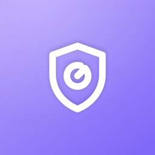</p>

# Wazuh SOC — iOS

Ứng dụng iPhone (SwiftUI, iOS 17+, không dùng thư viện ngoài) hiển thị toàn bộ thông tin của dashboard Wazuh (OpenSearch Dashboards 2.19 / Wazuh 4.14): SOC Home, màn hình theo từng thiết bị, săn cảnh báo, lỗ hổng CVE và quản trị hệ thống. Giao diện tối, tiếng Việt / English.

> Toàn bộ địa chỉ, tên máy và tên người dùng trong mã và ảnh chụp là **dữ liệu mẫu** (10.0.0.x, `DC01`, `pve01`, `web01`…). Ảnh chụp lấy từ máy chủ giả lập.

## Tính năng

| Tab | Nội dung |
|---|---|
| **Tổng quan** | Trạng thái manager & dịch vụ, agent active / disconnected, cảnh báo theo mức (Critical ≥15, High 12–14, Medium 7–11, Low 0–6), thẻ cho từng thiết bị (sự kiện / ≥7 / ≥12 + sparkline), thẻ CVE, biểu đồ cảnh báo theo mức độ |
| **Thiết bị** | Màn hình dựng từ cấu hình `DeviceConfig` — thêm thiết bị = thêm một cấu hình. Mỗi panel tự tải, lỗi panel nào hiện ở panel đó kèm "Thử lại" |
| **Cảnh báo** | Tìm kiếm (free text / `field:value`), lọc agent, nhóm rule, khoảng cấp độ, thời gian; cuộn vô hạn bằng `search_after`; chi tiết có `data.*`, GeoIP, MITRE, lọc nhanh theo IP / rule, JSON gốc |
| **CVE** | Theo mức độ, agent, gói, phân bố CVSS, năm công bố, hệ điều hành; danh sách Critical & High; lịch sử Active / Solved từ `vulnerability-detector` |
| **Hệ thống** | Agent (cảnh báo phiên bản cũ hơn manager, khởi động lại), thông tin / nhật ký / khởi động lại manager, hồ sơ máy chủ, tự làm mới, ngôn ngữ, giao diện |

Khoảng thời gian: 15 phút, 1 giờ, 24 giờ, 7 ngày, 30 ngày hoặc tuỳ chọn.

### Thiết bị mẫu (`Core/DeviceCatalog.swift`)

- **FortiGate** (`rule.groups:fortigate`): cho phép / chặn, IP nguồn / đích, băng thông (`sentdelta`/`rcvddelta`, dự phòng `sentbyte`/`rcvdbyte` cho log không phải interim) theo thời gian và theo interface, top talkers, top 20 ứng dụng, nhóm ứng dụng, zone, chính sách, dịch vụ / cổng, VPN, quốc gia + bản đồ, bản đồ nhiệt giờ × ngày, so sánh với 1 giờ / hôm qua / tuần trước.
- **NAS Synology** (`rule.groups:synology`): hoạt động theo loại, người dùng × giờ, truy cập tệp theo IP, đăng nhập, sự kiện hệ thống & lưu trữ.
- **UniFi AP** (`rule.groups:unifi`): client kết nối / ngắt, client × giờ, model / MAC AP, radio / VAP, tiến trình AP, RADIUS.
- **Agent Windows / Proxmox / Web server** (`agent.name:…`): CVE của agent, xác thực, sudo, FIM, SCA / CIS (Wazuh API), inventory (OS, CPU, RAM, interface, cổng lắng nghe, kết nối, dịch vụ, người dùng, tiến trình), thêm Windows event ID / logon type / khoá tài khoản, tác vụ Proxmox, log truy cập web (mã HTTP, đường dẫn, IP, quốc gia, request chậm, user agent, rule tấn công web).

Sửa `filter`, `address`, `agentName` trong `DeviceCatalog.swift` cho khớp hệ thống của bạn.

## Kết nối

- **Wazuh API** (cổng 55000): đăng nhập `POST /security/user/authenticate` (Basic) → JWT, tự đăng nhập lại khi 401.
- **Wazuh Indexer** (cổng 9200): `POST /<index>/_search` với aggregation. Các trường `data.*` là keyword nên tổng số byte được cộng bằng script painless.
- **Cloudflare Access**: nhập Service Token (Client ID + Secret) — app gửi `CF-Access-Client-Id` / `CF-Access-Client-Secret` ở mọi request, không theo chuyển hướng và báo rõ khi bị Access chặn.
- Tuỳ chọn chấp nhận chứng chỉ tự ký. Mật khẩu và Client Secret lưu trong Keychain.

## Build & cài đặt

Cần macOS + Xcode 16 trở lên.

```bash
./build_ipa.sh
```

Script tạo `WazuhMonitor.ipa` (chưa ký). Ký và cài lên iPhone bằng **Sideloadly** hoặc **AltStore** với Apple ID của bạn. Có sẵn workflow GitHub Actions (`.github/workflows`) để build IPA không cần máy Mac.

Hoặc mở `WazuhMonitor.xcodeproj` trong Xcode → chọn Team → Product → Archive → Distribute App → Ad Hoc / Development.

## Cấu hình máy chủ trong app

Hệ thống → máy chủ → **Thêm**:

| Trường | Ví dụ |
|---|---|
| Wazuh API | `https://wazuh-api.example.com` hoặc `https://10.0.0.5:55000` |
| Tài khoản API | `wazuh-wui` |
| Indexer | `https://wazuh-idx.example.com` hoặc `https://10.0.0.5:9200` |
| Tài khoản Indexer | `admin` |
| Cloudflare Client ID / Secret | nếu đặt sau Cloudflare Access (policy phải là **Service Auth**) |

Bấm **Kiểm tra kết nối** để thử riêng API và Indexer.

## Ảnh chụp

| | | |
|---|---|---|
| 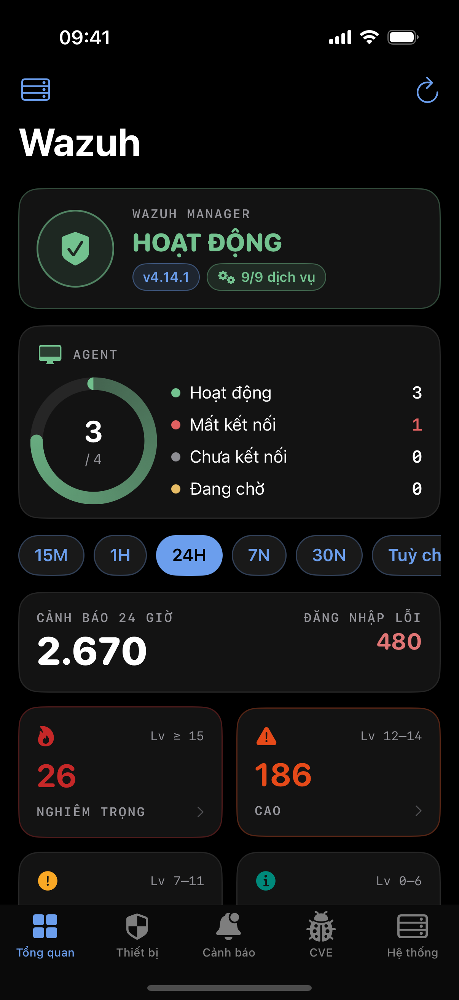 | 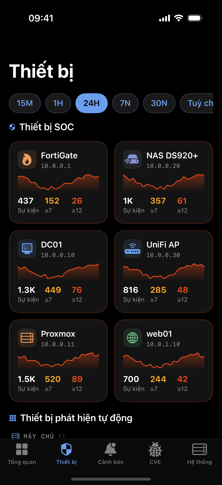 | 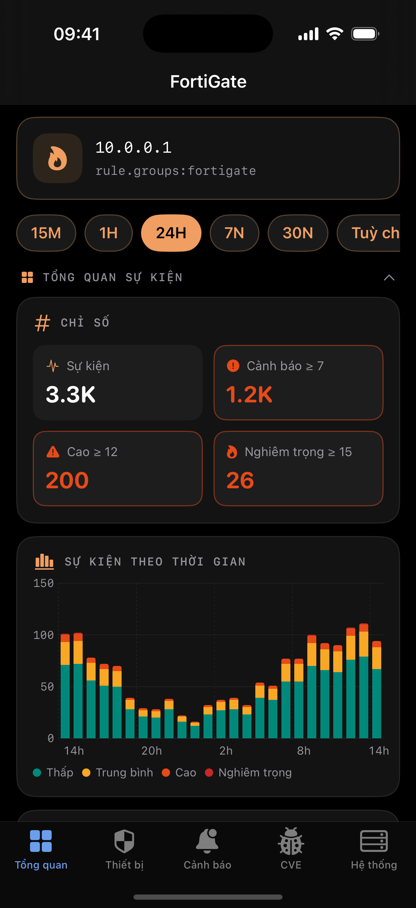 |
| 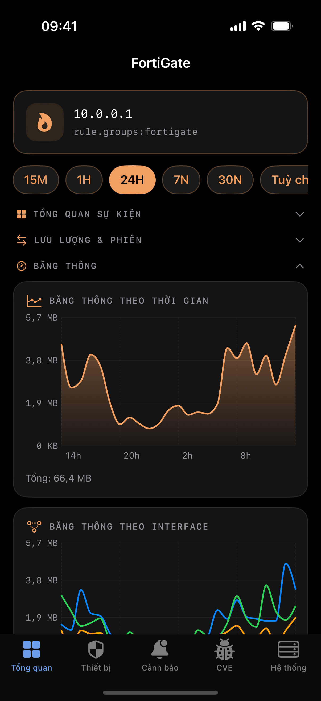 | 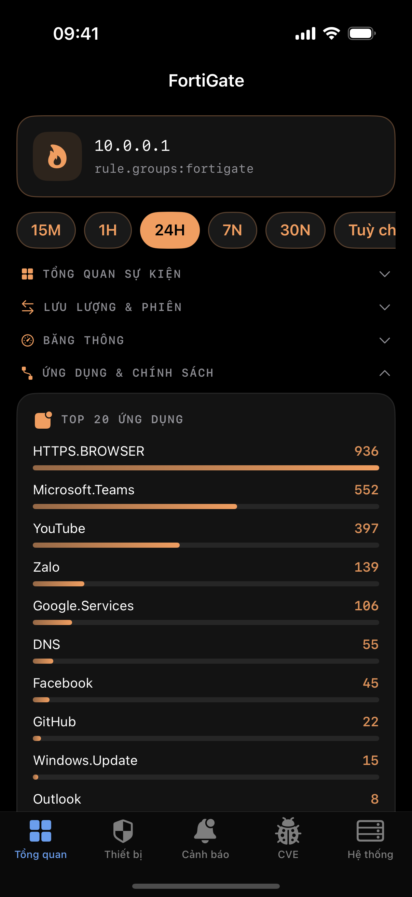 | 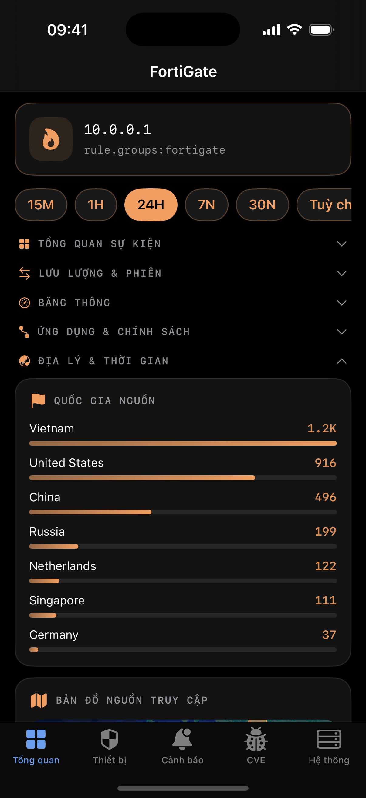 |
| 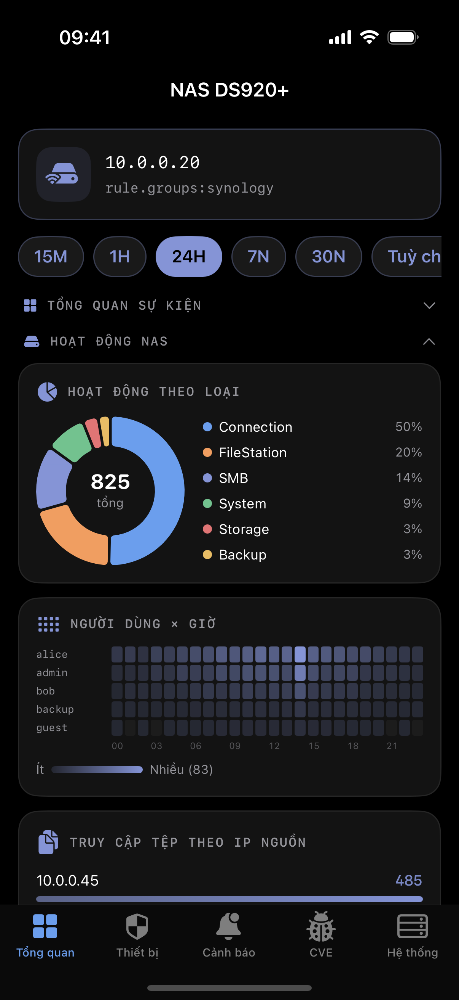 | 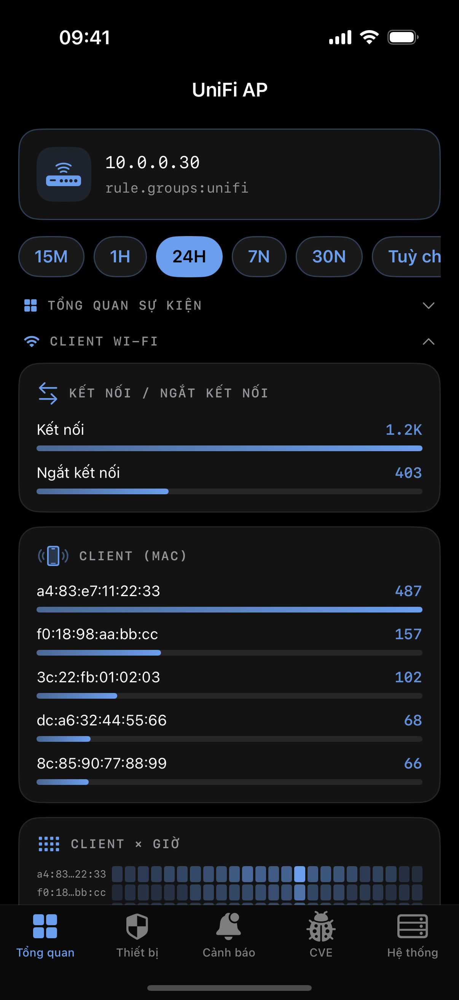 | 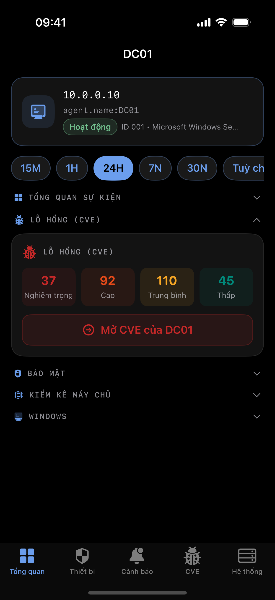 |
| 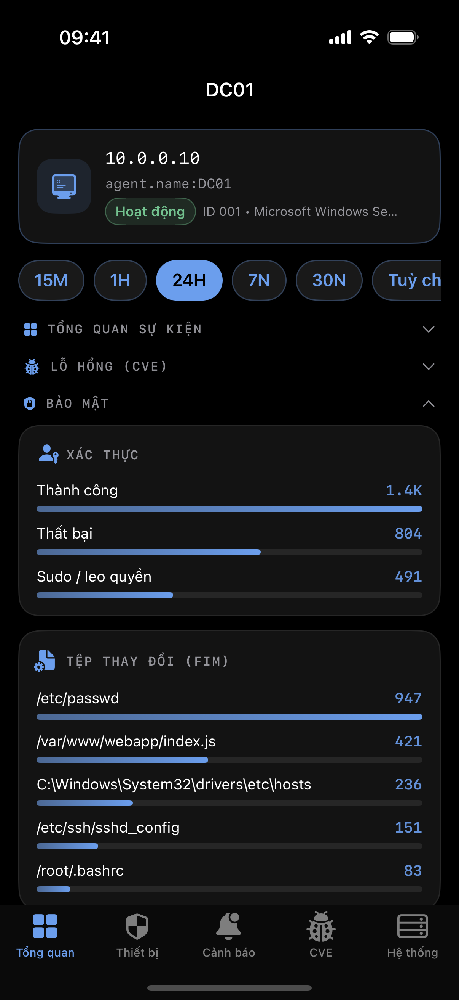 | 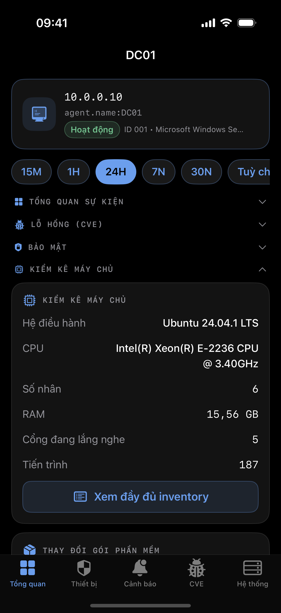 | 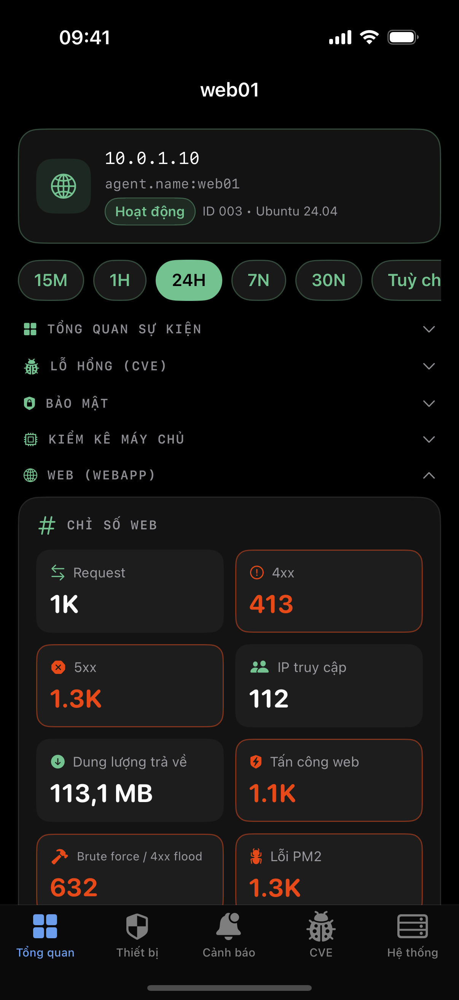 |
| 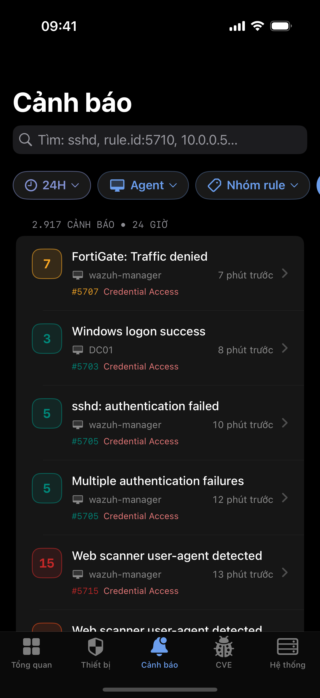 | 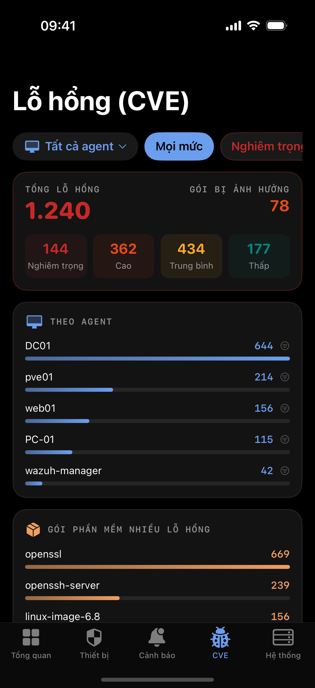 | 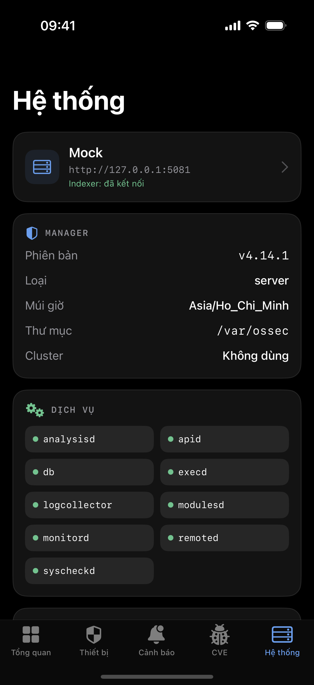 |

## Cấu trúc

```
WazuhMonitor/
  Core/   WazuhAPI (API + Indexer, CF Access, JWT), SOCQuery (query builder + panel engine),
          DeviceCatalog, Models, Localization, ServerStore (Keychain), Theme
  Views/  Dashboard, DeviceScreen, SOCCharts, Alerts, CVE, Agents, System, Modules, ServerViews
```

## Giấy phép

Phát hành theo giấy phép [MIT](LICENSE) — được tự do dùng, sửa và phát hành lại, miễn là giữ nguyên thông báo bản quyền.

Wazuh là thương hiệu của Wazuh Inc. Dự án này không liên kết hay được Wazuh Inc. bảo trợ. FortiGate, Synology, UniFi, Proxmox, Cloudflare là thương hiệu của chủ sở hữu tương ứng.
